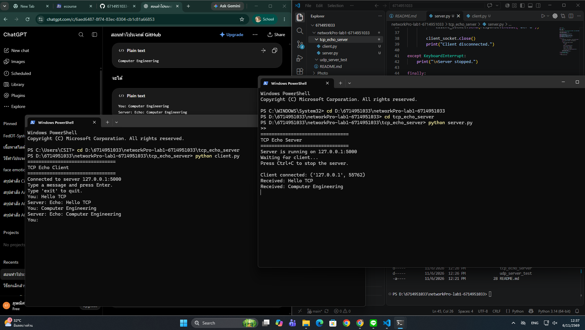
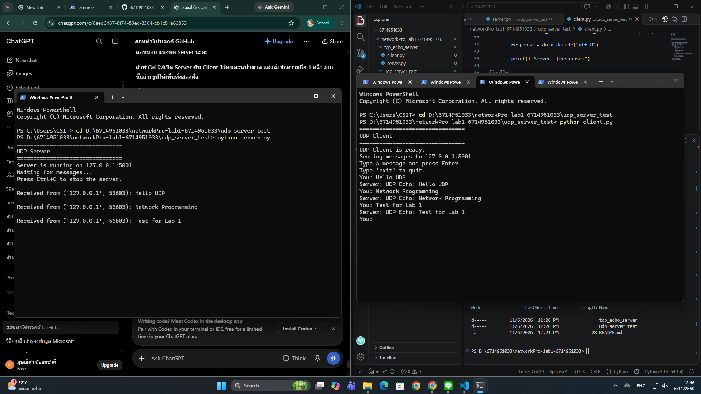

# Network Programming Lab 1

**Student ID:** 6714951033

## Project Description

This project demonstrates basic network programming using Python.  
The project implements TCP and UDP socket communication between a client and a server.

---

## 1. TCP Echo Server

The TCP Echo Server demonstrates reliable communication using TCP.

### Files

- `tcp_echo_server/server.py` - TCP Echo Server
- `tcp_echo_server/client.py` - TCP Client

### Test Result

The TCP client successfully connected to the server and sent messages.  
The server received the messages and returned them to the client using the Echo mechanism.

Example:

```text
You: Hello TCP
Server: Echo: Hello TCP

You: Computer Engineering
Server: Echo: Computer Engineering
```

### TCP Screenshot



---

## 2. UDP Server Test

The UDP Server demonstrates connectionless communication using UDP.

### Files

- `udp_server_test/server.py` - UDP Server
- `udp_server_test/client.py` - UDP Client

### Test Result

The UDP client successfully sent messages to the server.  
The server received the messages and returned the messages to the client using the UDP Echo mechanism.

Example:

```text
You: Hello UDP
Server: UDP Echo: Hello UDP

You: Network Programming
Server: UDP Echo: Network Programming

You: Test for Lab 1
Server: UDP Echo: Test for Lab 1
```

### UDP Screenshot



---

## Technologies

- Python 3
- TCP Socket
- UDP Socket
- Git
- GitHub

## Conclusion

The TCP and UDP communication programs were successfully implemented and tested on the local machine.